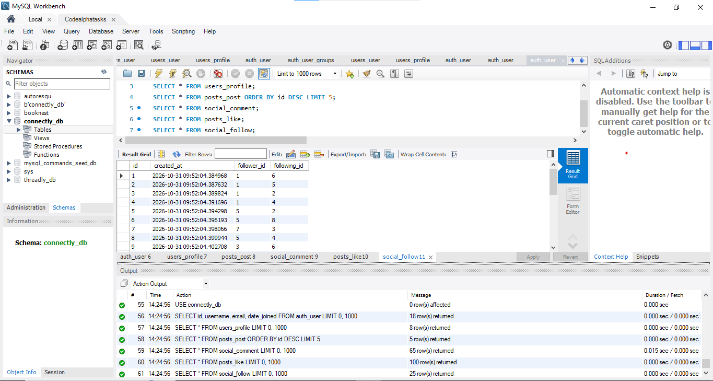

# Circle - Mini Social Media Platform

Circle is a mini social media web application built with **Django** and **MySQL**. Users can create profiles, publish posts, comment, like and follow other users. It was developed as **Task 2 (Social Media Platform)** of the CodeAlpha internship.

## Features

- **User profiles:** bio and avatar
- **Posts:** create posts with optional image upload
- **Comments:** comment on any post
- **Likes:** like and unlike posts
- **Follow system:** follow and unfollow users
- **Authentication:** JWT login (`djangorestframework-simplejwt`)
- **REST API** exposed under `/api/`
- **Frontend:** HTML, CSS and JavaScript

## Tech Stack

| Layer    | Technology                                   |
|----------|----------------------------------------------|
| Frontend | HTML, CSS, JavaScript                        |
| Backend  | Python, Django, Django REST Framework, JWT   |
| Database | MySQL                                        |

## Database

Users, posts, comments, likes and followers are stored in MySQL tables (for example `users_user`, `posts_post`, `social_comment`, `posts_like`, `social_follow`).

## Getting Started (local setup)

```bash
# 1. Clone the repository
git clone https://github.com/YOUR_USERNAME/CodeAlpha_SocialMediaPlatform.git
cd CodeAlpha_SocialMediaPlatform

# 2. Create and activate a virtual environment (Windows)
python -m venv venv
venv\Scripts\activate

# 3. Install dependencies
pip install -r requirements.txt
```

Create the MySQL database:

```sql
CREATE DATABASE connectly_db CHARACTER SET utf8mb4 COLLATE utf8mb4_unicode_ci;
```

Copy `.env.example` to `.env` and fill in your own values (database name, user, password, secret key). Then:

```bash
python manage.py migrate
python manage.py createsuperuser
python manage.py runserver 8008
```

Open http://127.0.0.1:8008/login/ in your browser.

The app runs on **port 8008** because port 8000 is very often already taken by another
project, which makes the frontend show *"Cannot reach Django backend"*. The frontend
auto-detects the API on ports 8008 and 8000, but the Django server itself must be running.

On Windows you can skip the manual steps and just double-click **`start.bat`**, which
creates the virtualenv if needed, applies migrations and starts the server on 8008.

## Quickstart with Docker (optional)

```bash
docker-compose up --build
docker-compose exec web python manage.py migrate
docker-compose exec web python manage.py createsuperuser
```

The Docker setup publishes the app on port 8000, so stop any other service using that
port first (or change the `ports` mapping in `docker-compose.yml`).

## API Endpoints

| Method | Endpoint                | Description                         |
|--------|-------------------------|-------------------------------------|
| POST   | `/api/token/`           | Obtain JWT                          |
| POST   | `/api/token/refresh/`   | Refresh JWT                         |
| GET    | `/api/profile/`         | Current user profile                |
| GET    | `/api/posts/`           | List posts                          |
| POST   | `/api/posts/`           | Create a post                       |
| POST   | `/api/posts/<id>/like/` | Like a post                         |
| DELETE | `/api/posts/<id>/like/` | Unlike a post                       |
| POST   | `/api/follow/`          | Follow a user (`{"user_id": 2}`)    |
| DELETE | `/api/follow/`          | Unfollow a user                     |
| GET    | `/api/followers/`       | List follower IDs                   |
| GET    | `/api/following/`       | List following IDs                  |

## Project Structure

```
manage.py
requirements.txt
.env.example
socialplatform/     # settings, urls, wsgi
core/ (or your app folders)  # models, serializers, views, urls
templates/          # HTML
static/             # CSS and JavaScript
```

## Screenshots

### Home Feed


### Profile Page


### MySQL Database


## Demo Video

*Add your YouTube or Google Drive link here.*

## Author

- **Name:** Roaim Mehdi
- **Student ID:** CA/DF1/322965
- **Internship:** CodeAlpha
- **GitHub:** [RoaimMehdi](https://github.com/RoaimMehdi)